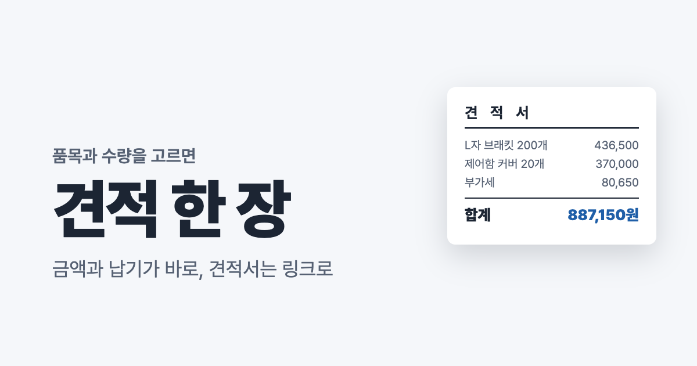

# 견적 한 장

거래처가 휴대폰으로 품목과 수량을 고르면 견적 금액과 납기가 바로 나오고, 견적서 한 장을 인쇄하거나 PDF로 저장하고, 링크로 보내는 웹이에요. `data.js`의 단가표만 바꾸면 우리 회사 견적기가 돼요.



빌드 도구도, 서버도, API 키도 없는 정적 웹이에요. 이 폴더를 그대로 GitHub에 올리고 Vercel로 배포하면 PC와 휴대폰 어디서나 열려요. 예시 회사(새벽금속)와 단가, 사업자번호, 주소는 모두 가상이에요.

## 폴더

```
index.html  style.css  app.js  data.js  og.png  favicon.svg
README.md     지금 읽는 설명서
AGENTS.md     AI 도구(Claude Code, Antigravity 등)에게 줄 규칙과 맥락. CLAUDE.md는 이 파일을 불러와요
docs/         plan.md(기획서)
```

| 파일 | 하는 일 |
|---|---|
| index.html | 화면 뼈대, 탭 제목, 링크 미리보기(og) 태그 |
| style.css | 모양. 색과 글꼴은 맨 위 `:root`, 인쇄 모양은 맨 아래 `@media print` |
| app.js | 동작. 금액 계산은 `price()` 한 함수 |
| data.js | **고쳐 보는 곳.** 회사, 재질, 표면 처리, 품목, 수량 할인, 빠른 납기, 색 |
| og.png | 카카오톡, 슬랙에 링크를 보낼 때 나오는 그림(1200x630) |

## 1. 내 컴퓨터에서 열어 보기

- `index.html`을 더블클릭하면 브라우저에서 열려요. 계산, 견적서, 인쇄까지 이것만으로 다 돼요
- 휴대폰 화면은 크롬 개발자 도구(F12)에서 휴대폰 모양 아이콘을 눌러 확인해요
- 보내기 버튼처럼 https 주소에서만 되는 기능은 배포한 뒤에 확인해요

## 2. 우리 회사로 바꾸기 (data.js)

| 바꾸고 싶은 것 | 고칠 곳 |
|---|---|
| 회사 이름, 소개, 메일 | `COMPANY`. 개인 연락처 대신 회사 대표 메일을 권해요 |
| 품목과 단가 | `ITEMS`. base는 개당 기준 단가(원), minQty는 최소 수량, leadDays는 보통 납기(영업일) |
| 재질, 표면 처리 | `MATERIALS`의 rate(단가 배수), `FINISHES`의 rate(더하는 비율). 품목마다 고를 수 있는 것은 `ITEMS`의 materials, finishes에 id로 |
| 수량 할인 | `TIERS`. `{ qty: 300, off: 0.05 }`는 300개 이상 5% 할인 |
| 빠른 납기 | `RUSH`. rate만큼 더하고 납기를 cut만큼 줄여요 |
| 견적서 아래 안내 | `COMPANY.notes` 한 줄씩 |
| 색 | `THEME.accent`. 흰 글자가 잘 보이는 진한 색으로 |
| 링크 미리보기 문구 | index.html 위쪽 og:title, og:description도 같이 바꿔요(미리보기는 data.js를 못 읽어요) |

저장하고 브라우저를 새로 고치면 바로 보여요. 따옴표와 쉼표를 지우면 화면이 비어요. 그럴 땐 개발자 도구 콘솔의 빨간 줄을 보면 몇 번째 줄인지 나와요.

AI에게 맡겨도 돼요. 예: "data.js의 품목을 우리 회사 품목 셋으로 바꾸고, 수량 300개 넘으면 5% 할인을 넣어 줘. 다른 파일은 고치지 마."

## 3. GitHub에 올리기

1. GitHub에서 New repository, 이름은 `quote`처럼 영어로, Public으로 만들어요
2. 빈 레포 화면의 "uploading an existing file"을 눌러요
3. **압축을 푼 이 폴더 안의 파일과 폴더를 모두** 끌어다 놓아요. zip 파일째 올리면 안 돼요. `index.html`이 레포 맨 위에 있어야 해요
4. Commit changes

## 4. Vercel로 배포하기

1. vercel.com에 GitHub 계정으로 로그인
2. Add New > Project > 방금 만든 레포 Import
3. Framework Preset은 "Other" 그대로, 다른 칸은 비워 두고 Deploy
4. 1분쯤 뒤 나온 주소(`○○.vercel.app`)를 휴대폰으로 열어요

## 5. 배포한 뒤

- GitHub에서 `data.js`를 열고 연필 아이콘으로 단가 한 줄을 바꿔 Commit하면, Vercel이 알아서 다시 배포해요. 1분 뒤 주소를 새로 고쳐 보세요
- `index.html`의 `og:image`를 `https://내주소/og.png`처럼 전체 주소로 바꾸면 링크 미리보기가 확실하게 나와요

## 확인 목록

- [ ] 품목을 고르고 재질, 표면 처리, 수량, 납기를 바꾸면 개당 금액, 줄 금액, 납기가 바로 바뀐다
- [ ] 최소 수량보다 적게 적으면 담기 버튼이 막히고 안내가 나온다
- [ ] 100개, 500개, 1000개를 넘으면 할인이 붙는다
- [ ] 담은 견적의 공급가액, 부가세(10%), 합계, 예상 출고일이 맞다
- [ ] 견적서 보기 › 인쇄, PDF 저장에서 견적서 한 장만 나온다
- [ ] 링크 복사로 받은 주소를 새 창에 열면 '받은 견적'으로 같은 견적서가 나온다(받는 회사 이름은 링크에 없다)
- [ ] 휴대폰(세로)과 PC(넓은 화면) 모두 가로로 넘치는 곳이 없다

## 주의

- **Vercel 무료 요금제(Hobby)는 개인, 비상업 용도만 돼요.** 수업에서 만들고 시연하는 것은 괜찮지만, 실제 회사 거래에 쓰려면 회사 계정과 유료 요금제로 옮겨요
- 화면의 금액은 자동 계산한 참고 견적이에요. 정식 견적은 담당자가 확인해 드리는 흐름을 그대로 두세요
- 실제 사업자번호, 개인 연락처는 넣지 않는 것을 기본으로 해요
- 담은 견적과 받는 회사 이름은 이 브라우저(localStorage)와 화면에만 남고, 어디로도 보내지 않아요. 바깥으로 나가는 요청은 글꼴뿐이에요
